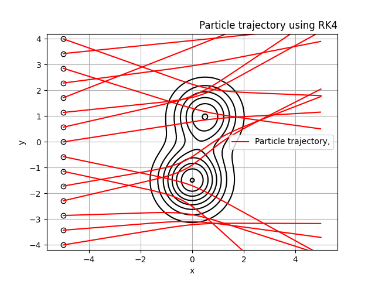
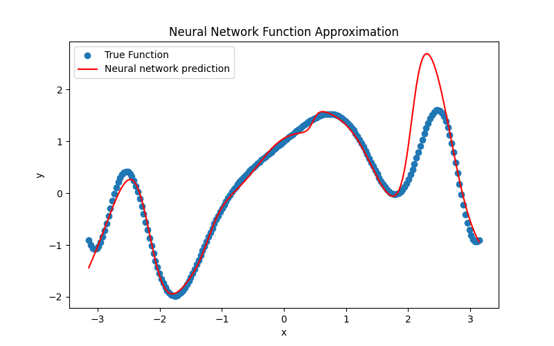

<ins>Exercise 1</ins>

This maps the behaviour of a particle when moving towards a potential, paths calculated using RK4. 

---

<ins>Exercise 2</ins>

For exercise 2 I  have combined the numerical calculations of the derivative with the analytic one using JAX and have compared the results. 

Final angle: -0.19925086
Finite difference derivative: -0.013127923
JAX derivative: -0.013757351

---

<ins>Exercise 3</ins>

---

<ins>Exercise 4</ins>

The following plots refers to the values used in the code supplied. 

Questions:
- **Why should the initial W be random rather than 0?**
  All the neurons would end up holding the same value, eliminating the benefit of having many neurons in the first place
- **Why do we not need to apply the activation function to the last layer?**
  It does not have to lie in the range -1 to 1 (and indeed, should not). 

 Model performance:

 
 

