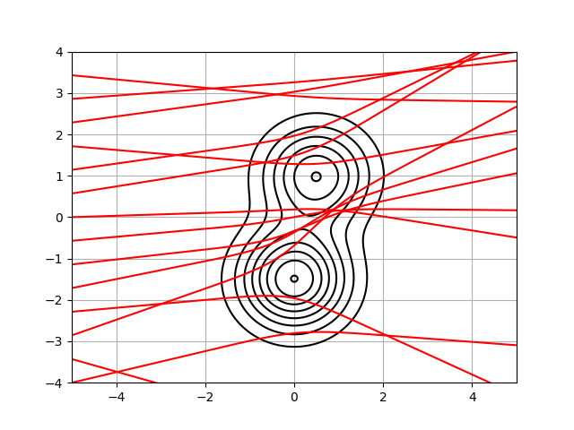
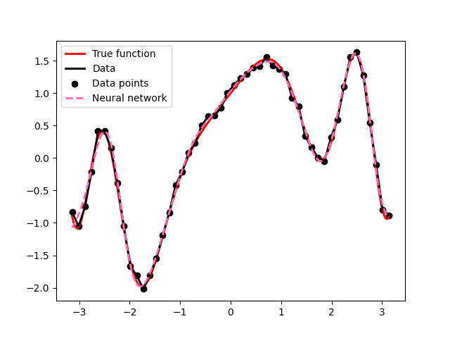
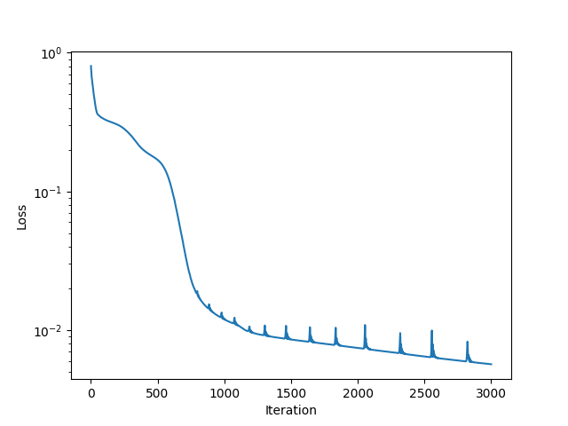

## Pendulum - week 1
- This code numerically integrates the path of a particle through a potential. 
- The function RK4 uses the derivatives (calculated by hand here) of the particles position and velocity, given by the equations of motion, to predict the next position and velocity of the particle.
- The particles all start from x=-L with horizontal velocity of 2.5 and vertical velocity between -1 and 1.
- The RK4 function is applied repeatedly to create a trajectory of the particle from x=-L to x=L. These trajectories are shown on the figure below along with the potential.

## Pendulum - week 2
- This code integrates the pendulum equation of motion using the RK4 method from week 1.
- Calculates and compares the finite difference derivative and the derivative calculated using jax.grad. 
- To estimate l so that the pendulum reaches a final angle of theta_f, the newton method for root finding is used. Starting with an initial value of g/l, the predicted final angle is calculated and compared with theta_f. The derivative is then used to update the value of g/l. This process is repeated for 10 iterations before returning the final angle.

## Pendulum - week 2/3
- A set of angle data points is created using a known value of l and RK4 formula on the equations of motion, with a small amount of random noise added for realistic effect.
- To estimate g/l from the data points the newton method for optimisation is used. Starting from an initial value of g/l, the error is calculated and its first and second derivatives are used to update the value of g/l. This process is repeated with the new value of g/l for 50 iterations before the final estimate for l is compared to the actual value of l.

## Neural network - week 4
- A set of data points is created by using a random generator to add Gaussian noise to the function evaluated values.
- The initial weights and biases are randomly generated rather than being set to zero. This is because if all the weights were zero, then they would all update the same, which cancels out the benefit of having 16 neurons compared to 1 neuron.
- The weights and biases are applied to the input value, with tanh being applied at each layer except the last one. The output layer does not use tanh because the final output does not need to be restricted to between -1 and 1.
- The loss function and its derivatives with respect to each weight are then calculated. These derivatives are then used by the optimiser to update the weights and biases to reduce the loss function. This process is repeated for 3000 iterations before the final weights and biases are used to plot the predicted function, as shown on the figure below.
- The loss is recorded for each iteration and plotted on a logarithmic scale against iteration number, as shown below.

Comments:
- Increasing the number of layers or the number of neurons in each layer reduces the loss much faster, since the network has more parameters so can adjust and fit the data better. However, if there are too many layers or neurons the network learns the random noise as well as the data points, so it becomes inaccurate of the true function.
- 

