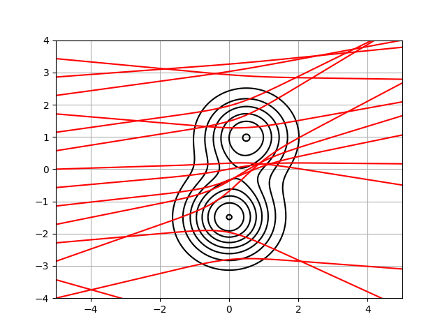

## Pendulum week 1
Numerically integrates the path of a particle through a potential. 
The function RK4 uses the derivatives (calculated by hand in this case) to predict the next position and velocity of the particle.
The particles all start from x=-L with horizontal velocity of 2.5 and vertical velocity between -1 and 1.
The RK4 step is then looped to create a trajectory of the particle from x=-L to x=L.

---
