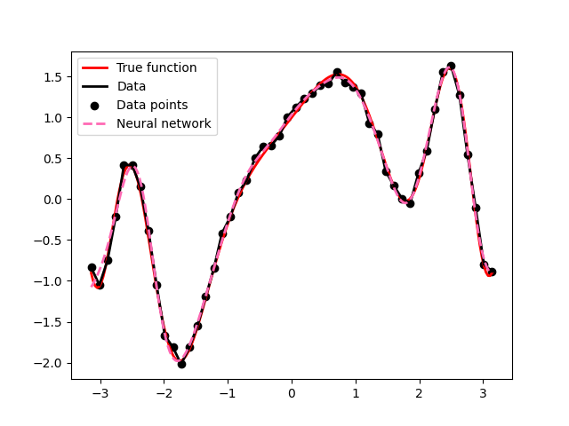
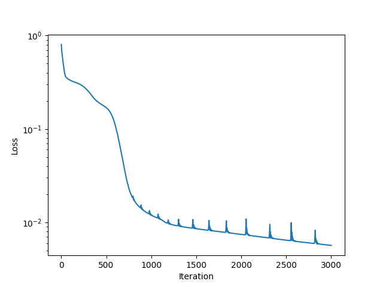

## Pendulum - week 1
- Numerically integrates the path of a particle through a potential. 
- The function RK4 uses the derivatives (calculated by hand in this case) to predict the next position and velocity of the particle.
- The particles all start from x=-L with horizontal velocity of 2.5 and vertical velocity between -1 and 1.
- To create a trajectory of the particle from x=-L to x=L, the RK4 function is looped over.

## Pendulum - week 2
- Integrates the pendulum equation of motion using the RK4 method from week 1.
- Calculates and compares the finite difference derivative and the grad derivative.
- To estimate l so that the pendulum reaches a final angle of theta_f, use the newton method for root finding where the function, f, is the difference between the predicted final angle and theta_f. Starting with an initial value of l, calculate the ratio g/l and the predicted final angle. Then use the derivative of f to update g/l. This process is looped with the new value of g/l for 10 iterations before returning the final angle after time T.

## Pendulum - week 2/3
- A set of angle data points is created using the actual value of l and RK4 formula on the equations of motion, with a small amount of random noise added for realistic effect.
- To deduce g/l from the data points the newton method for optimisation is applied. Starting from an initial value of l, and calculating g/l. The first and second derivatives of the error are used to update g/l. This process is then looped with the new value of g/l. After 50 iterations the final estimate for l is compared to the actual value of l.

## Neural network - week 4
- To generate a set of data points use a random generator to add Gaussian noise to the function evaluated values.
- Start by creating initial values for the weights and biases. The weights should be random rather than zero else all the weights would update the same from the gradient, which cancels out the benefit from having 16 neurons.
- The weights and biases are then applied to the starting value, with tanh being applied at each layer except the last one. This is because the output value does not need to be in the range -1 to 1, unlike the internal values. This process is then repeated for all data points.
- The loss function and its derivatives with respect to each weight are then calculated. These derivatives are then used in the optimiser to update the weights and biases to minimise the loss function. This process is repeated for 3000 iterations before the final weights and biases are used to plot the predicted function.
- The loss is recorded for each iteration and plotted on a logarithmic scale.

Comments:
- Increasing the number of layers or the number of neurons in each layer reduces the loss much faster, since the network has more parameters so can adjust and fit the data better. However, if there are too many layers or neurons the network learns the random noise as well as the data points, so it becomes inaccurate of the true function.
- 

